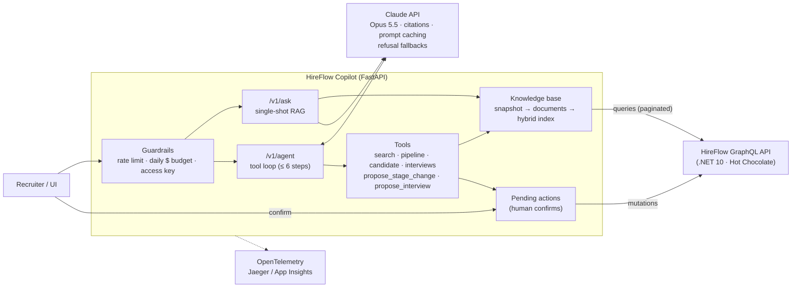

<div align="center">

# 🧭 HireFlow Copilot

**An AI assistant for recruiters, built on top of the [HireFlow](https://github.com/AutumnTrace/hireflow) GraphQL API:
retrieval-augmented answers with citations, and a tool-using Claude agent that can read the pipeline and propose changes.**

Python 3.12 · FastAPI · Claude (Anthropic SDK) · hybrid BM25 + vector search · OpenTelemetry · Docker · Azure Container Apps

[](https://github.com/AutumnTrace/hireflow-copilot/actions/workflows/ci.yml)


[](LICENSE)

[Quick start](#-quick-start) · [Architecture](#-architecture) · [RAG](#-retrieval) · [Agent](#-agent) · [Evals](#-evals) · [Guardrails](#-cost-guardrails) · [Observability](#-observability) · [Deploy](#-deploy-to-azure) · [Design decisions](#-design-decisions)

</div>

---

## ✨ What it does

| | |
|---|---|
| 🔎 **Cited answers** (`POST /v1/ask`) | Retrieves the most relevant HireFlow records and gives them to Claude as `search_result` blocks. Every claim in the answer links back to the job, candidate or interview note it came from. |
| 🤖 **Agent** (`POST /v1/agent`) | Claude chooses among 7 tools (search, list jobs, read a pipeline, look up a candidate, upcoming interviews, propose a stage change, propose an interview) and loops until it can answer. |
| 🧑‍⚖️ **Human in the loop** | The agent cannot change anything in HireFlow. Write tools create a *pending action*. A recruiter confirms it with `POST /v1/actions/{id}/confirm`, which calls the real `moveApplication` / `scheduleInterview` mutations. |
| 🔗 **Integrates with an existing system** | Reads HireFlow over GraphQL with cursor pagination and JWT auth, maps its typed mutation errors (`InvalidStageTransitionError`, …) and mirrors its stage state machine. |
| 📏 **Evals in CI** | An offline retrieval eval (hit@k, MRR, recall) gates every build. A live end-to-end eval with a spend cap runs on demand. |
| 💸 **Safe on a personal API key** | Per-client rate limits, a global daily USD budget computed from real token usage, a `max_tokens` cap, an agent step cap and an optional access key. |
| 📡 **Observable** | JSON logs plus OpenTelemetry spans for every request, retrieval, model call and tool call, exported to the console, any OTLP backend (Jaeger is in compose) or Azure Application Insights. |
| 🧪 **Runs without a key** | Demo mode: search and extractive answers work, and nothing is spent. |

## 🚀 Quick start

You need [uv](https://docs.astral.sh/uv/). It installs the right Python by itself.

```bash
git clone https://github.com/AutumnTrace/hireflow-copilot && cd hireflow-copilot
uv sync
uv run hireflow-copilot            # http://localhost:8000/docs
```

That starts in **demo mode** against a bundled copy of HireFlow's seed data (plus a few extra candidates, see [`hireflow_seed.json`](src/hireflow_copilot/data/hireflow_seed.json)). To use Claude:

```bash
cp .env.example .env               # set ANTHROPIC_API_KEY=...
uv run hireflow-copilot
```

```bash
curl -s localhost:8000/v1/ask -H 'content-type: application/json' \
  -d '{"question": "Who has production RAG experience, and what did the interviewer think?"}'

curl -s localhost:8000/v1/agent -H 'content-type: application/json' \
  -d '{"message": "Who should move forward for the AI Engineer role? Propose next steps."}'
```

### Against a real HireFlow API

Run [HireFlow](https://github.com/AutumnTrace/hireflow) (`dotnet run --project src/HireFlow.Api`), then:

```bash
COPILOT_SOURCE=graphql COPILOT_HIREFLOW_URL=http://localhost:5230/graphql uv run hireflow-copilot
```

The copilot gets a recruiter token from HireFlow's development `/auth/token` endpoint. Set `COPILOT_HIREFLOW_TOKEN` to use your own instead.

### Inside HireFlow Web

[HireFlow Web](https://github.com/AutumnTrace/hireflow-web) has a **Copilot** panel that calls this API:

- **Live mode:** run HireFlow, this copilot with `COPILOT_SOURCE=graphql`, and the web app connected to the same API. Proposals come back with their mutation input (`proposed_actions[].params`), and the web app applies them with its own HireFlow session, so the board updates through its existing subscription. Browser access is limited to `COPILOT_CORS_ORIGINS` (by default the Vite dev and preview servers).
- **The public demo** runs entirely in the browser, with no copilot server. It replays real answers recorded against `COPILOT_FIXTURE=web-demo`: the same dataset the demo board shows, exported by the web repo's `scripts/export-demo-data.ts`. To refresh them:

```bash
uv run python scripts/record_answers.py ../hireflow-web/src/copilot/recorded.json --budget 0.50
```

### Whole stack in Docker

```bash
docker compose up --build
```

This starts PostgreSQL, HireFlow (built straight from its GitHub repo), Jaeger for traces, and the copilot reading live from HireFlow.

| Service | URL |
|---|---|
| Copilot (Swagger UI) | http://localhost:8000/docs |
| HireFlow GraphQL IDE | http://localhost:8080/graphql |
| Jaeger traces | http://localhost:16686 |

## 🏗 Architecture



```
src/hireflow_copilot/
├── main.py              FastAPI app, routes, dependency-injected guardrails
├── config.py            all settings, from env vars (COPILOT_*)
├── guard.py             rate limiter + daily spend ledger
├── knowledge.py         snapshot cache and index rebuilds
├── hireflow/            GraphQL client, fixture client, typed domain models
├── rag/                 documents, embeddings, BM25 + RRF hybrid index, /ask
├── agent/               tool definitions and the agent loop
├── llm/                 Claude wrapper, pricing, citation rendering
└── observability.py     JSON logs, OpenTelemetry exporters
evals/                   retrieval eval (offline) and live eval (real API)
infra/azure/main.bicep   Container Apps + Log Analytics + Application Insights
```

## 🔎 Retrieval

Every HireFlow record becomes a document. Each document is split into short **blocks**: one for the summary line, one per cover letter, one per stage note, one per interview's feedback. Claude cites whole blocks, so short blocks make each citation point at exactly the sentence it relies on.

Search is **hybrid**:

- **BM25** (about 30 lines, [`rag/index.py`](src/hireflow_copilot/rag/index.py)) catches exact terms: `C#`, `Kafka`, `62k`. The tokenizer keeps `.NET` and `C#` whole.
- **Dense vectors** from `BAAI/bge-small-en-v1.5`, run locally on CPU through [fastembed](https://github.com/qdrant/fastembed) (Claude has no embeddings endpoint), catch paraphrases such as *"automates browser testing"* → Playwright.
- **Reciprocal Rank Fusion** merges the two rankings without having to calibrate their very different score scales.

`POST /v1/search` returns the ranking with each document's `dense_rank` and `sparse_rank`, so you can see why something matched without spending tokens.

## 🤖 Agent

[`agent/loop.py`](src/hireflow_copilot/agent/loop.py) is a hand-written tool loop. I didn't use the SDK's tool runner because each step needs control the runner doesn't give:

- a **budget check before every model call**, not only at the start of the request,
- tool results returned as **`search_result` blocks**. Their order must be tracked so the citations in the final answer can be resolved to sources,
- a **hard step limit**. Parallel tool calls run concurrently, and their results go back in a single message.

Tool inputs are validated with Pydantic. A bad id or an illegal stage move goes back to Claude as an `is_error` result with the allowed stages, so it can correct itself instead of failing the request. The tools mirror HireFlow's state machine (`APPLIED → SCREENING → INTERVIEW → OFFER → HIRED`, plus `REJECTED` / `WITHDRAWN` from any active stage), so an illegal move is refused before it ever reaches the API.

## 📏 Evals

### Retrieval: offline, on every push

[`evals/retrieval.yaml`](evals/retrieval.yaml) has 20 questions, each with the records a good search must surface. Four of them are paraphrases with almost no words in common with the data. CI fails if the hybrid hit@5 drops below 0.9.

```bash
uv run python evals/run_retrieval.py
```

Current results (28 documents, `bge-small-en-v1.5`, k = 5):

| retriever | hit@5 | MRR | recall@5 |
|-----------|------:|----:|---------:|
| BM25 only | 0.95 | 0.75 | 0.88 |
| dense only | 0.85 | 0.63 | 0.75 |
| **hybrid (RRF)** | **1.00** | **0.75** | **0.90** |

On a corpus this small, keyword search is strong and dense retrieval on its own is weaker. Fusing them is the only setup that finds a relevant record for every question. That is the reason to measure instead of assuming "vectors are better".

### End to end: live, on demand

[`evals/answers.yaml`](evals/answers.yaml) has 8 deterministic checks against the real API (no LLM judge). They cover required facts, forbidden hallucinations, an expected citation source, required tool calls and the expected number of proposals. One case asks for something HireFlow doesn't store, to check that the model says so instead of inventing an answer.

```bash
uv run python evals/run_live.py --budget 0.50     # key from ANTHROPIC_API_KEY or .env
```

In GitHub Actions it is a manual workflow (`Live eval`) with a budget input, so it never runs by accident.

Latest run (Claude Opus 5.5, `low` effort for `/ask`, `medium` for the agent): **8/8 passed, about $0.18 in total.**

| case | endpoint | tools the agent chose | cost | time |
|---|---|---|---:|---:|
| kafka | ask | | $0.015 | 3.3s |
| rejection-reason | ask | | $0.018 | 3.6s |
| offer-amount | ask | | $0.014 | 2.4s |
| unknown (not in HireFlow) | ask | | $0.016 | 3.1s |
| ai-shortlist | agent | list_jobs, get_job_pipeline, search_hireflow | $0.062 | 11.0s |
| interviews-this-week | agent | upcoming_interviews | $0.016 | 4.5s |
| illegal-move | agent | get_candidate | $0.006 | 4.1s |
| propose-move | agent | get_candidate, propose_stage_change | $0.019 | 6.6s |

The first run failed `illegal-move`, and the eval was what was wrong. Asked to mark Ana as hired, the agent found her at INTERVIEW, explained that only OFFER, REJECTED or WITHDRAWN come next, and *asked* before proposing OFFER, exactly as the system prompt says. The case had required a proposal, so I changed it to check the right behaviour: explain the rule and propose nothing unasked.

<details>
<summary><b>Example agent answer</b>: "Who are the strongest applicants for the AI Engineer (LLM & RAG) job, and why?"</summary>

> The job has only two applicants, and **Victoria Sandu** is clearly the stronger of the two.
>
> **1. Victoria Sandu: the strongest by a wide margin (in Screening)**
> - **Skill match:** 80%: has Python, LLM, RAG, Azure; missing Docker.[1] She does run her system on Azure Container Apps, so she has probably used containers, but check Docker directly.
> - **Has built this kind of system for real users:** At my current company I built a RAG assistant over 40k support tickets: hybrid BM25 plus vector retrieval, citations on every answer, and a nightly eval set of 300 questions that gates releases.[1]
> - **Strong phone screen:** Irina Balan rated 5/5: Explained chunking trade-offs and how she measured retrieval recall before and after a re-ranker.[1]
>
> **2. Sergiu Botnari: weaker fit (still Applied, not yet reviewed)**
> - **Skill match:** 40%: has Python, Docker; missing LLM, RAG, Azure.[2]
> - He has solid backend skills, but he'd be learning LLM work on the job.
>
> **Next step:** Victoria is a natural fit to move to Interview. I can set that up as a pending action for a recruiter to confirm.

Tools called: `list_jobs` → `get_job_pipeline` → `search_hireflow`. `[n]` markers come from Claude's native `search_result_location` citations, and the response's `sources` array carries the exact quoted text.

</details>

## 💸 Cost guardrails

This is meant to run publicly on a personal API key, so spend is bounded at several levels:

| Limit | Default | Where |
|---|---|---|
| Requests per client per minute / day | 5 / 40 | `RateLimiter` in [`guard.py`](src/hireflow_copilot/guard.py) |
| Global spend per UTC day | $1.00 | `SpendLedger`, fed by real `usage` from each response |
| Tokens per model call (thinking + answer) | 4096 | `max_tokens` |
| Model calls per agent request | 6 | `max_agent_steps`, checked against the budget before each step |
| Question length | 1000 chars | request validation |
| Access key | off | `COPILOT_ACCESS_KEY` → `X-Copilot-Key` header |

Blocked requests get `429` with a `Retry-After` header. `GET /v1/usage` shows today's spend. Cost is computed from `input_tokens`, `output_tokens` and cache reads and writes at the price of the model that actually served the response (which can differ when a refusal fallback runs).

Other cost levers: the system prompt and tool list are byte-stable, so they are served from the **prompt cache**. Today's date goes in the user turn, not the system prompt, so the prefix never changes. Effort is `low` for single-shot Q&A and `medium` for the agent.

The counters live in process memory, which is exact for one replica (the Bicep pins it to one). To scale out, move them to Redis (`INCR` + `EXPIRE`). As a backstop, also set a monthly limit on the key in the Anthropic Console.

## 📡 Observability

- **Logs**: one JSON object per line, with the active `trace_id`. Every Claude call logs the request id, served model, stop reason, token counts, cache hits, cost and latency.
- **Traces**: FastAPI request → `retrieval.search` / `agent.step` → `claude.messages.create` → `tool.<name>`, with `gen_ai.*` token attributes and `copilot.cost_usd`. The Anthropic SDK's own spans nest underneath.
- **Exporters**: `COPILOT_OTEL_EXPORTER=console | otlp | azure`. `azure` uses the Azure Monitor distro and reads `APPLICATIONINSIGHTS_CONNECTION_STRING`. Install it with `uv sync --extra azure`. The Docker image already includes it.

## ☁️ Deploy to Azure

[`infra/azure/main.bicep`](infra/azure/main.bicep) creates a Log Analytics workspace, Application Insights and a Container Apps environment, plus the app itself (external ingress, liveness probe, secrets for the API key). CI compiles it on every push and publishes the image to `ghcr.io/autumntrace/hireflow-copilot`.

```bash
az group create -n rg-hireflow-copilot -l westeurope
az deployment group create -g rg-hireflow-copilot -f infra/azure/main.bicep \
  -p anthropicApiKey=""        # empty = demo mode, no spend
```

Or run the manual **Deploy to Azure** workflow, which authenticates with OIDC (no stored Azure credentials).

## 🧠 Design decisions

- **Retrieval reads a snapshot, writes go through the API.** The copilot reads the whole pipeline in three paginated queries and rebuilds the index every 5 minutes and after each confirmed write. At demo scale that takes milliseconds. At real scale I would index incrementally from HireFlow's `onApplicationStageChanged` subscription into Azure AI Search or pgvector, keeping the same `search()` interface.
- **The model proposes, a human decides.** For an ATS, an agent that can reject candidates on its own is a liability. Proposals are cheap to review and keep an audit trail in HireFlow's stage history.
- **Native citations instead of "cite your sources" in the prompt.** `search_result` blocks make Claude return structured `search_result_location` citations. The API renders them as `[n]` markers with the exact quoted text, with no regex parsing of model output.
- **Refusal fallbacks are on.** With `fallbacks: "default"`, a request declined by a safety classifier is re-run server-side on Anthropic's recommended fallback model instead of failing. It is configurable with `COPILOT_REFUSAL_FALLBACKS`.
- **Deterministic evals before LLM judges.** String and tool-call checks are cheap, reproducible and easy to debug. A judge model would be the next step for grading open-ended answer quality.
- **Fakes, not mocks, for Claude in tests.** Tests replay scripted `BetaMessage` responses through a fake client and assert on the exact requests sent: search result blocks, tool result shape, step limits, budget cut-offs. They need no key and no network.

## 🛠 Development

```bash
uv sync
uv run pytest                 # 36 tests, no network, no key
uv run ruff check . && uv run ruff format --check .
uv run mypy                   # strict
uv run python evals/run_retrieval.py --embedder hashing   # no model download
```

## Related

- [**HireFlow**](https://github.com/AutumnTrace/hireflow): the .NET 10 / Hot Chocolate GraphQL API this reads from
- [**HireFlow Web**](https://github.com/AutumnTrace/hireflow-web): the React pipeline board ([live demo](https://autumntrace.github.io/hireflow-web/))

## License

[MIT](LICENSE)
